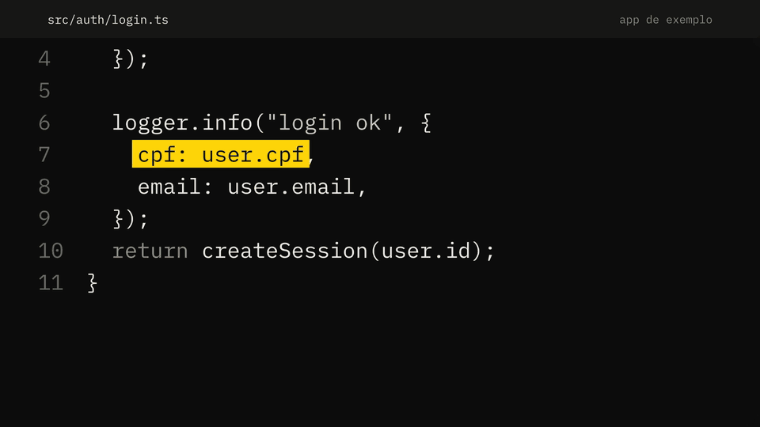

# lgpd-skills — LGPD Privacy Engineering Toolkit

> [Português](./README.md)

> **AI-assisted privacy auditing, implementation and governance for software projects.**
> A modular, orchestrated **Agent Skills** toolkit — compatible with **Claude Code, Codex, Gemini CLI, Cursor and OpenCode** — for technical code diagnosis, privacy-engineering controls, and living governance artifacts under **Law No. 13.709/2018 (LGPD)**, **ANPD** (Brazil's National Data Protection Authority) rules (through Nov/2026), and **Law No. 15.211/2025 + Decree No. 12.880/2026 (ECA Digital)**.

[](./LICENSE)
[](./.github/workflows/ci.yml)
[](./CONTRIBUTING.md)
[](https://www.planalto.gov.br/ccivil_03/_ato2015-2018/2018/lei/l13709.htm)
[](https://www.planalto.gov.br/ccivil_03/_ato2023-2026/2025/lei/l15211.htm)

<p align="center"><a href="./assets/lgpd-skills-demo.mp4"></a></p>

---

## Table of contents

- [What it is (and what it is not)](#-what-it-is-and-what-it-is-not)
- [When to use it](#-when-to-use-it)
- [Installation](#-installation)
- [How to use it](#-how-to-use-it)
- [Legal disclaimer](#%EF%B8%8F-legal-disclaimer)

Further sections (the 19 skills, living `.lgpd/` artifacts, normative coverage, automated quality checks, contributing, and license) live in the [Portuguese README](./README.md).

---

## 🎯 What it is (and what it is not)

`lgpd-skills` is a **Privacy Engineering Toolkit** made of **19 coordinated Agent Skills**:
- **1 orchestrator** (`lgpd-audit`) that detects security emergencies without ceremony, manages step dependencies, keeps state in `.lgpd/`, and pauses at required checkpoints;
- **18 specialized sub-skills**, runnable on their own or as a pipeline.

### Real scope: code vs. organizational compliance

No tool that only looks at a code repository can "certify" or guarantee that an organization is fully compliant in a legal sense. This toolkit draws transparent boundaries:

| What the toolkit DOES in the repository | What still NEEDS human, legal, and operational validation outside the repo |
|---|---|
| Inspects schemas, routes, SDKs, cookies, mobile permissions, and IaC to map real data flows | Prove that contracts/DPAs were actually signed outside Git, and that vendor practices match them |
| Implements executable, tested code (consent event ledger, DSAR routes, field encryption, serialized *hash chain*) | Audit internal human processes, team training, informal support channels, and operational culture |
| Structures living technical drafts under `.lgpd/` (ROPA, RIPD (data-protection impact report), LIA, incident runbook, policy draft) | Validate legal-basis choices, legitimate-interest balancing, sector retention rules, and public texts with the **Encarregado** (DPO) and legal counsel |
| Flags risky settings and separates express legal requirements from engineering good practice | Verify IAM, secrets, backups, and networks directly in the production cloud environment |

---

## 🧭 When to use it

| Scenario | Pipeline | Initial behavior |
|---|---|---|
| **Active or suspected security incident** | **Pipeline D (Fast-Path)** | Triggers containment, evidence preservation, and a `T+0` record **immediately**, without waiting for general discovery (3 business days — Res. 15/2024) |
| **Greenfield project** (*privacy-by-design*) | **Pipeline A** | Preliminary map → legal basis → Encarregado/ATPP channel → vendors/transfers → technical controls → ROPA/RIPD/Policy |
| **Legacy system in production** | **Pipeline B** | Reverse discovery from code → prioritized gap matrix (P0/P1/P2) → incremental retrofit |
| **Hybrid codebase** (legacy + new features) | **Pipeline C** | Legacy diagnosis through vendors + full controls on new features |

---

## 📦 Installation

Follows the open **Agent Skills** pattern ([agentskills.io](https://agentskills.io)) with native support for 5 agents:

### Any agent (via [skills.sh](https://skills.sh/goul4rt/lgpd-skills))
```bash
npx skills add goul4rt/lgpd-skills
```

### Claude Code
```text
/plugin marketplace add goul4rt/lgpd-skills
/plugin install lgpd-skills@lgpd-skills
```

### Codex (CLI / App)
```bash
codex plugin marketplace add goul4rt/lgpd-skills
codex plugin add lgpd-skills@lgpd-skills
```

### Gemini CLI
```bash
gemini extensions install https://github.com/goul4rt/lgpd-skills
```

### Cursor
Run `/add-plugin` in the editor and provide `https://github.com/goul4rt/lgpd-skills`.

### OpenCode
Add to `opencode.json` (details in [`.opencode/INSTALL.md`](./.opencode/INSTALL.md)):
```json
{
  "plugin": ["lgpd-skills@git+https://github.com/goul4rt/lgpd-skills.git"]
}
```
> **OpenCode note:** enable it explicitly through the `skill` tool (e.g. *"use a skill lgpd-audit"*).

### Manual installation
```bash
git clone https://github.com/goul4rt/lgpd-skills.git /tmp/lgpd-skills
cp -r /tmp/lgpd-skills/skills/lgpd-* ~/.claude/skills/
rm -rf /tmp/lgpd-skills
```

---

## 🚀 How to use it

### Structured diagnosis and governance
```text
You: run a privacy and LGPD diagnosis of this project

Agent: [activates lgpd-audit]
  → Asks for scenario (A Greenfield / B Legacy / C Hybrid) and ATPP framing (Res. 2/2022)
  → [L1] lgpd-legacy-retrofit: inspects schemas, routes, SDKs, cookies and produces .lgpd/discovery.md + .lgpd/gaps.md
  → ⏸ CHECKPOINT — waits for validation before continuing
  → [L2] lgpd-data-mapping → [L3] lgpd-legal-basis → [L4] lgpd-dpo-encarregado → ... → ROPA / RIPD / Policy
```

### Active incident (immediate trigger)
```text
You: we just found an endpoint exposing customer CPFs and emails

Agent: [activates lgpd-audit → Fast-Path Pipeline D → emergency lgpd-incident-response]
  → Records T+0, guides immediate containment and forensic preservation, evaluates Art. 5 of Res. 15/2024
```

---

## ⚠️ Legal disclaimer

**This project is a privacy-engineering tool and is not legal advice or a compliance certification.** Decisions about legal bases, notifying the ANPD of incidents, signing contracts/DPAs, residual risk assessment, and publishing policies require validation by the **Encarregado (DPO)** and by a **lawyer who specializes in data protection**.

The skills help with engineering work. They do not replace counsel or the Encarregado.
