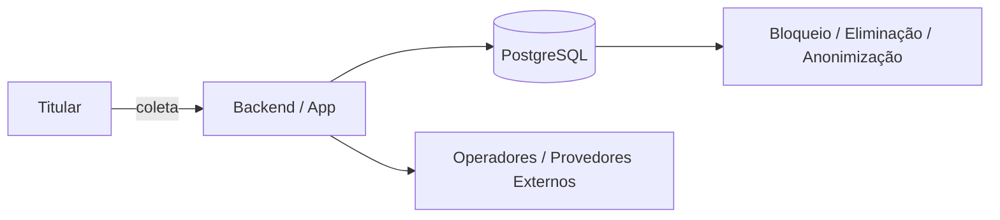

# RIPD — Relatório de Impacto à Proteção de Dados Pessoais

**Atividade**: {A00X — nome}
**Slug**: `{ripd-slug}`
**Natureza da emissão**: `{Alto risco (teste cumulativo Res. 2/2022 Art. 4º) | Legítimo interesse (Art. 10, § 3º) | Preventivo (boa prática de gestão de risco)}`
**Controlador**: {razão social e CNPJ}
**Encarregado (ou canal ATPP)**: {nome e contato}
**Equipe envolvida**: {engenharia, produto, segurança, jurídico}
**Versão**: v{N} | **Data**: {data}

---

## 1. Sumário executivo e enquadramento de risco

{2–3 parágrafos resumindo a operação, o motivo da elaboração deste RIPD e a conclusão sobre o risco residual.}

### Verificação do teste cumulativo (Res. CD/ANPD nº 2/2022, Art. 4º)
- **Critérios gerais**:
  - [ ] Larga escala multifatorial (titulares estimados, volume de atributos, duração/frequência e abrangência geográfica): `{análise concreta}`
  - [ ] Potencial de afetar significativamente interesses e direitos fundamentais: `{análise concreta}`
- **Critérios específicos**:
  - [ ] Tecnologias emergentes ou inovadoras (ex.: IA/ML, biometria)
  - [ ] Vigilância ou controle de zonas acessíveis ao público
  - [ ] Decisões unicamente automatizadas / definição de perfis (*profiling*)
  - [ ] Dados sensíveis ou dados de crianças, adolescentes ou idosos

## 2. Descrição do tratamento e ciclo de vida dos dados

- **Categorias de titulares**: `{adultos | adolescentes | crianças | idosos | colaboradores}`
- **Atributos pessoais comuns e sensíveis**: `{listar}`
- **Sistemas internos**: `{tabelas, filas, caches, buckets}`
- **Agentes externos e seus papéis**: `{listar cada terceiro como Operador, Controlador Independente ou Conjunto + país}`

## 3. Necessidade, proporcionalidade e princípios (Art. 6º LGPD)

- **Teste de necessidade**: a finalidade poderia ser atingida sem estes dados ou com dados anonimizados/sintéticos? `{justificar}`
- **Alternativas menos intrusivas avaliadas e descartadas**: `{descrever}`

| Princípio (Art. 6º) | Evidência técnica e organizacional |
|---|---|
| I — Finalidade | `{finalidade determinada, explícita e informada}` |
| II — Adequação | `{compatibilidade com o contexto informado ao titular}` |
| III — Necessidade | `{campos mínimos + TTL definido}` |
| IV — Livre acesso | `{consulta facilitada via /api/me e canal do Encarregado}` |
| V — Qualidade dos dados | `{validação cadastral, retificação e controle contra alucinação/erro}` |
| VI — Transparência | `{política em linguagem clara + informações sobre agentes e IA}` |
| VII — Segurança | `{TLS, criptografia de storage/coluna, controle de acesso, KMS}` |
| VIII — Prevenção | `{modelagem de ameaças LINDDUN, testes antes de produção}` |
| IX — Não discriminação | `{auditoria de viés algorítmico e vedação de variáveis proibidas}` |
| X — Responsabilização | `{logs de auditoria, LIA/RIPD versionados e governança}` |

## 4. Base legal e direitos dos titulares (Arts. 7º, 11, 14, 18 e 20)

- **Base legal**: `{Art. 7º/11 + inciso}` — `{resumo da justificativa}`
- **Melhor interesse (se envolver crianças/adolescentes — Art. 14 + Enunciado 1/2023)**: `{análise ou N/A}`
- **Exercício de direitos**:
  - Confirmação e acesso (`/api/me` e `/api/me/export`), correção (`/api/me/profile`), eliminação/bloqueio (`/api/me/erasure`), revogação de consentimento (`/api/consent/revoke`) e revisão/explicação de decisões automatizadas quando aplicável (Art. 20).

## 5. Modelagem de ameaças (LINDDUN + IA) e matriz de riscos

| ID | Ameaça / Risco concreto | Categoria | P (1-5) | I (1-5) | Nível (P×I) | Controles mitigatórios | Risco residual |
|---|---|---|---|---|---|---|---|
| R01 | Vazamento de PII em logs/telemetria de terceiros | Disclosure | 3 | 4 | 12 | Redação de PII no logger + revisão de SDK | 3 (baixo) |
| R02 | Inferência de atributo sensível ou re-identificação | Detecting / Linking | 2 | 4 | 8 | Pseudonimização HMAC + k-anonymity ≥ 5 | 2 (baixo) |
| R03 | Viés discriminatório ou erro em modelo/automação (Art. 6º, IX / Art. 20) | IA / Profiling | 2 | 5 | 10 | Avaliação de métricas por subgrupo + canal de revisão e explicação | 4 (médio-baixo) |
| R04 | Retenção/treinamento externo ou vazamento entre tenants em LLM/RAG | IA / Disclosure | 2 | 5 | 10 | Zero-data-retention contratual, filtro de PII no prompt e isolamento por tenant | 3 (baixo) |

## 6. Salvaguardas técnicas e administrativas verificadas

- [ ] Criptografia em trânsito (TLS) e criptografia de armazenamento/volume gerenciada pela nuvem
- [ ] Criptografia em nível de aplicação/coluna para atributos de alta criticidade (quando aplicável)
- [ ] Controle de acesso por menor privilégio (RBAC) + MFA administrativo
- [ ] Trilha de auditoria íntegra e monitorada
- [ ] Contratos/DPAs (Art. 39) e mecanismo válido de transferência internacional (Res. 32/2026 ou Res. 19/2024)
- [ ] Runbook de resposta a incidentes testado (Res. 15/2024)

## 7. Parecer do Encarregado e Decisão

- **Parecer do Encarregado**: `{favorável | favorável com condicionantes | desfavorável}` — `{fundamentação}`
- **Decisão do Controlador**:
  - [ ] Prosseguir conforme especificado
  - [ ] Prosseguir somente após implementar condicionantes: `{listar}`
  - [ ] Suspender / redesenhar a atividade

**Assinaturas / Aprovação**:
- Encarregado: `{nome}` — `{data}`
- Responsável pelo produto/sistema: `{nome}` — `{data}`

## 8. Gatilhos de revisão obrigatória
- Revisão periódica em `{data}` ou imediatamente diante de mudança de finalidade, inclusão de novas categorias sensíveis/menores, adoção de IA/decisão automatizada, troca de operador crítico ou incidente de segurança relacionado.
